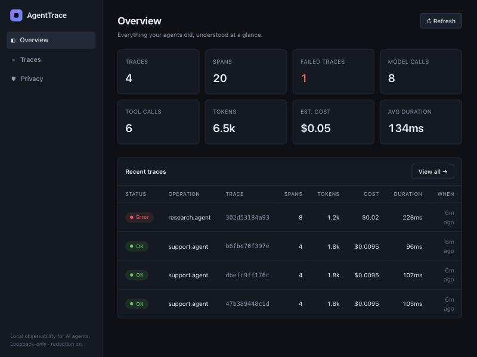

<p align="center">
  
</p>

<h1 align="center">AgentTrace</h1>

<p align="center">
  When an AI agent run goes wrong, AgentTrace shows you what it did and where it broke.
</p>

I built AgentTrace because debugging an agent run meant grepping through scattered
logs and guessing at the order things happened in. It records a structured span
for every run, model call, tool call, approval, retry and error, then lets me
replay the whole execution and jump to the span that actually failed. It takes
after OpenTelemetry in shape, but it is aimed squarely at AI agents rather than
general request tracing.



---

## Why I built it

An agent run spreads itself across logs: the prompt here, the model call there,
tool calls, retries, latency, token usage, the failure somewhere in the middle.
Reconstructing that by hand is slow and error-prone. AgentTrace gives a run one
structured, queryable shape, a trace tree with timing, status, token and cost
metadata, and tool arguments redacted by policy, plus a local viewer to walk
through it.

It runs local-first and private by default. The collector binds to loopback, and
secrets are redacted before they are ever written to disk, not just hidden in the
UI.

## How it compares

The agent-observability space is crowded. Langfuse, Arize Phoenix, Helicone and
OpenLLMetry are all here, and several of them self-host too. So AgentTrace is not
trying to be a general LLM-tracing platform. It is a narrower, more opinionated
take, and the differences are deliberate.

The data is shaped like an agent run, not a request log. Approvals, retries and
tool calls are first-class span types, so a failed run reads as a tree you follow
down rather than flat spans you have to reassemble.

Redaction happens before anything is persisted. Secrets are stripped at the SDK
and again at the collector before a write, not filtered out at display time.

And it is one binary with no account and loopback by default. You run
`docker compose up` (or a single collector binary) plus a static viewer, and
nothing leaves your machine unless you opt in.

If you need multi-tenant dashboards and a managed service, a hosted tool will be
more mature than this. AgentTrace is for the developer who just wants their
agent's full execution locally, with no project to create and no keys to hand
over.

## Features

| Feature | What it does |
| --- | --- |
| **Execution tracing** | Every run is a complete parent/child span tree |
| **Model observability** | Provider, model, tokens, cost, latency, retries |
| **Tool observability** | Tool name, status, execution time, policy-redacted args |
| **Failure analysis** | The exact failed span and its ancestors, highlighted |
| **Historical replay** | Step through recorded execution - never re-runs anything |
| **Privacy** | Redaction before persistence, raw payloads off by default |
| **Export** | OTLP/JSON and portable native JSON |


## Architecture

```
AI agent (SDK)  ──spans──▶  Collector (axum + SQLite)  ──JSON──▶  Viewer (React)
                            validate · redact · store              waterfall · replay
```

- **SDK** (`crates/agenttrace`) - Rust instrumentation: schema, ids, tracer,
  redaction, exporters, OTLP mapping, optional `tracing` bridge.
- **Collector** (`crates/agenttrace-collector`) - axum service over SQLite:
  ingest, validate, redact-at-boundary, query, export, retention, viewer hosting.
- **Viewer** (`viewer/`) - React + Vite trace UI.
- **Sample agent** (`crates/sample-agent`) - fully instrumented demo.

There is more detail in [`docs/architecture.md`](docs/architecture.md).

## Quick start

### Docker

```bash
docker compose up --build -d
```

Then produce some traces and open the viewer:

```bash
cargo run -p sample-agent        # sends traces to the collector
open http://127.0.0.1:4357/
```

### Local (no Docker)

```bash
npm --prefix viewer install && npm --prefix viewer run build
cargo run --release -p agenttrace-collector &   # API + viewer on :4357
cargo run -p sample-agent                        # generate traces
```

## SDK example

```rust
use agenttrace::{Tracer, SpanType};
use agenttrace::export::HttpExporter; // feature = "http"

let tracer = Tracer::new(HttpExporter::new("http://127.0.0.1:4357"));
let mut run = tracer.start_run("support.agent");

let mut model = run.child(SpanType::ModelCall, "chat.completion");
model.set_model("anthropic", "claude-opus-4").set_tokens(850, 210).set_cost(0.02);
model.end();

let mut tool = run.child(SpanType::ToolCall, "search_docs");
tool.set_tool_name("search_docs");
tool.end();

run.end();          // also auto-closes on drop
tracer.shutdown();  // flush before a short-lived process exits
```

## Example trace

The sample agent produces this failure, which you can inspect span by span in the
viewer:

```
research.agent                      error   228ms
├─ plan                   model     ok       50ms   claude-opus-4  640→180 tok
├─ web_search             tool      ok       50ms
│  └─ rank_results        model     ok       15ms   claude-haiku-4
├─ approve_fetch          approval  ok        6ms
├─ fetch_page             tool      error    56ms   TimeoutError
└─ fetch_page.retry       retry     error    60ms
   └─ fetch_page          tool      error    60ms   TimeoutError (attempt 2)
```

## Using the viewer

The collector serves the viewer at **http://127.0.0.1:4357/**. It hosts the built
static bundle, so you do not need to run a separate dev server.

- **Overview** - totals at a glance: traces, spans, failed traces, model/tool calls, tokens, estimated cost, average duration, and the most recent runs.
- **Traces** - every run as a row (status, operation, spans, tokens, cost, duration), filterable by status, type, provider, model, text, duration and time.
- **Trace detail** - the execution waterfall: a parent/child span tree with per-span timing bars, color-coded by type (run, model, tool, approval, retry). Failed spans are highlighted, and selecting a span opens its full detail (model, tokens, cost, tool arguments, error). **Replay** steps through the recorded run and never re-executes your agent.
- **Export** - download any trace as native JSON or OTLP from the detail view.

## Security and privacy

- The collector binds to loopback only, so there is no public exposure by default.
- API keys, tokens, passwords and auth headers are redacted before persistence, at
  both the SDK and the collector.
- Raw prompts and tool arguments are not stored unless you opt in.
- Storage fails closed: if a secret shape survives redaction, the span is dropped
  rather than written raw.
- CORS is scoped to local origins; responses carry `nosniff`, frame-deny and a
  tight CSP; internal errors are not echoed back to clients.

The full model and its limits are in [`docs/privacy.md`](docs/privacy.md) and
[`SECURITY.md`](SECURITY.md).

## API

| Method | Path | Purpose |
| --- | --- | --- |
| `POST` | `/v1/spans` | Ingest spans (`{"spans":[…]}`, array, or one) |
| `GET` | `/v1/traces` | List traces (filter by status, type, provider, model, search, duration, time) |
| `GET` | `/v1/traces/:id` | All spans of a trace |
| `GET` | `/v1/traces/:id/export?format=native\|otlp` | Export |
| `GET` | `/v1/stats` | Overview metrics |
| `GET` | `/v1/config` | Effective privacy/runtime settings |
| `GET` | `/healthz` | Health check |

## Configuration

The collector reads `AGENTTRACE_*` environment variables and falls back to safe
defaults. Binding to a non-loopback host is allowed, but it gets logged as
unhardened so you notice.

| Variable | Default | Purpose |
| --- | --- | --- |
| `AGENTTRACE_HOST` | `127.0.0.1` | Bind address (loopback by default). |
| `AGENTTRACE_PORT` | `4357` | Port for the API and viewer. |
| `AGENTTRACE_DB` | `agenttrace.db` | SQLite database path. |
| `AGENTTRACE_VIEWER_DIR` | `viewer/dist` | Built viewer to serve. |
| `AGENTTRACE_CAPTURE_PAYLOADS` | `false` | Store raw prompts/tool args. Secrets are still masked; off by default. |
| `AGENTTRACE_MAX_BODY_BYTES` | `4194304` | Max ingest body (4 MiB). |
| `AGENTTRACE_RETENTION_DAYS` | `30` | Spans older than this are pruned. |
| `RUST_LOG` | - | Standard `tracing` filter, e.g. `agenttrace_collector=debug`. |

You can read the effective settings at runtime from `GET /v1/config`.

## Documentation

- [Architecture](docs/architecture.md)
- [Schema & semantic conventions](docs/schema.md)
- [Privacy & security model](docs/privacy.md)
- [Deployment](docs/deployment.md)
- [Development](docs/development.md)
- [Venus Agent integration](docs/venus-integration.md)
- [Implementation status](IMPLEMENTATION_STATUS.md)

## OpenTelemetry compatibility

AgentTrace is OpenTelemetry-inspired, not an OpenTelemetry implementation, and I
want to be precise about what that means rather than wave the OTel logo around.

| Aspect | Status | Detail |
| --- | --- | --- |
| Trace id width | Compatible | 128-bit, lowercase hex, same as W3C/OTel trace ids |
| Span id width | Compatible | 64-bit, lowercase hex, same as OTel span ids |
| Parent/child | Compatible | `parent_span_id` references the parent span id; root has none |
| Span status | Compatible | `unset`/`ok`/`error` map to OTLP status codes `0`/`1`/`2` |
| OTLP/JSON export | Supported, tested | `GET /v1/traces/:id/export?format=otlp` emits an `ExportTraceServiceRequest`; `gen_ai.*` conventions for model fields, `agenttrace.*` for the rest |
| OTLP ingestion | Not supported | The collector ingests only the native `POST /v1/spans` format; there is no OTLP receiver |
| W3C trace-context propagation | Not supported | No `traceparent`/`tracestate` inject or extract; ids are generated per run, not continued from an upstream context |
| OTLP/gRPC and protobuf | Not supported | Export is JSON only |
| Metrics / logs signals | Not supported | Traces only |

So the data model and ids line up with OpenTelemetry well enough to export a trace
into an OTLP/JSON backend, but AgentTrace is not a drop-in OTel SDK or collector
and it will not join an existing distributed trace.

## Performance

I measured these locally on a single machine, release build, SQLite in WAL mode,
loopback HTTP, using the sample agent's span shapes. This is not a proper
benchmark suite, so treat it as a rough probe. You can reproduce it with
`scripts/bench.sh`, and your numbers will move with hardware and payload size.

The table below is still blank on purpose. I have not run the probe enough to put
numbers I trust here, and I would rather leave it empty than publish made-up
figures.

| Metric | Value | Method |
| --- | --- | --- |
| Ingestion throughput | _to be filled_ | spans/sec via batched `POST /v1/spans` |
| Storage per span | _to be filled_ | SQLite file growth / spans stored, payloads off |
| Storage per trace | _to be filled_ | ~7 spans/trace in the sample |
| Trace list query | _to be filled_ | `GET /v1/traces` p50 over a populated DB |
| Trace detail query | _to be filled_ | `GET /v1/traces/:id` p50 |

Retention is time-based: spans older than `AGENTTRACE_RETENTION_DAYS` (default 30)
are pruned on startup and then hourly.

## What it does not do yet

- It is single-node and SQLite-backed. I built it for local, single-developer use,
  not for a multi-tenant hosted service.
- OTLP is export-only. Spans come in through the native format; full OTLP
  ingestion is still on the roadmap.
- There is no authentication. The collector assumes a loopback, single-user
  setup, and there is no auth for a remote mode yet.
- Redaction is key/value masking, not free-text content inspection. It catches
  known secret shapes and common secret keys, and raw payload capture stays off by
  default.

## Roadmap

- Full OTLP ingestion (export already works today).
- More storage backends behind the existing storage interface.
- Richer dashboard aggregates, like per-model cost and latency trends.
- An optional authenticated remote mode.

## Tech stack

Rust (SDK + collector), SQLite, axum, React + Vite + TypeScript, Docker.

## License

Aymane Amounas Noncommercial Attribution License 1.0. Free for personal,
educational, research and hobby use; commercial use needs a separate written
agreement. See [LICENSE](LICENSE).

---
<sub>Built by [Aymane](https://github.com/aymane-amounas)</sub>
