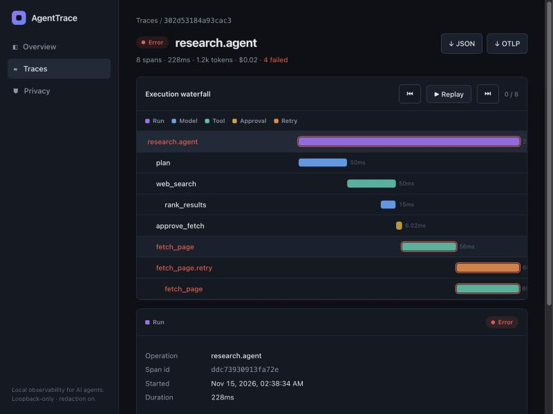

<p align="center">
  
</p>

<h1 align="center">AgentTrace</h1>

<p align="center">
  <strong>See everything your AI agent does. Understand why it does it. Find out where it fails.</strong>
</p>

AgentTrace is an OpenTelemetry-inspired observability platform built specifically
for AI agents. When an agent fails, you shouldn't have to grep scattered logs to
reconstruct what happened - AgentTrace records structured spans for every run,
model call, tool call, approval, retry and error, and lets you replay the whole
execution and find the exact span that broke.


---

## Why

Agent runs are hard to debug: prompts, model calls, tool calls, retries, latency,
token usage and failures end up spread across logs. AgentTrace gives them one
structured, queryable shape - a trace tree with timing, status, token/cost
metadata, and tool arguments redacted by policy - and a local-first viewer to
explore it.

It is **local-first and private by default**: the collector binds to loopback,
and secrets are redacted *before* they are ever written to disk.

## How it compares

The agent-observability space is crowded (Langfuse, Arize Phoenix, Helicone,
OpenLLMetry and others), and several of them can self-host too. AgentTrace is a
deliberately narrow, opinionated take rather than a general LLM-tracing platform:

- **Shaped like an agent run, not a request log.** Approvals, retries and tool
  calls are first-class span types, so a failed run reads as a tree you follow -
  not flat spans you reassemble.
- **Redaction before persistence.** Secrets are stripped at the SDK *and* the
  collector before anything is written, not filtered at display time.
- **One binary, no account, loopback by default.** `docker compose up` (or a
  single collector binary) plus a static viewer. Nothing leaves your machine
  unless you opt in.

If you need multi-tenant dashboards and a managed service, a hosted tool will be
more mature. AgentTrace is for the developer who wants their agent's full
execution locally, with no project to create and no keys to hand over.

## Features

| Feature | What it does |
| --- | --- |
| **Execution tracing** | Every run is a complete parent/child span tree |
| **Model observability** | Provider, model, tokens, cost, latency, retries |
| **Tool observability** | Tool name, status, execution time, policy-redacted args |
| **Failure analysis** | The exact failed span and its ancestors, highlighted |
| **Historical replay** | Step through recorded execution - never re-runs anything |
| **Privacy** | Redaction before persistence, raw payloads off by default |
| **Export** | OTLP/JSON and portable native JSON |



## Architecture

```
AI agent (SDK)  ──spans──▶  Collector (axum + SQLite)  ──JSON──▶  Viewer (React)
                            validate · redact · store              waterfall · replay
```

- **SDK** (`crates/agenttrace`) - Rust instrumentation: schema, ids, tracer,
  redaction, exporters, OTLP mapping, optional `tracing` bridge.
- **Collector** (`crates/agenttrace-collector`) - axum service over SQLite:
  ingest, validate, redact-at-boundary, query, export, retention, viewer hosting.
- **Viewer** (`viewer/`) - React + Vite trace UI.
- **Sample agent** (`crates/sample-agent`) - fully instrumented demo.

See [`docs/architecture.md`](docs/architecture.md).

## Quick start

### Docker

```bash
docker compose up --build -d
```

Then produce some traces and open the viewer:

```bash
cargo run -p sample-agent        # sends traces to the collector
open http://127.0.0.1:4357/
```

### Local (no Docker)

```bash
npm --prefix viewer install && npm --prefix viewer run build
cargo run --release -p agenttrace-collector &   # API + viewer on :4357
cargo run -p sample-agent                        # generate traces
```

## SDK example

```rust
use agenttrace::{Tracer, SpanType};
use agenttrace::export::HttpExporter; // feature = "http"

let tracer = Tracer::new(HttpExporter::new("http://127.0.0.1:4357"));
let mut run = tracer.start_run("support.agent");

let mut model = run.child(SpanType::ModelCall, "chat.completion");
model.set_model("anthropic", "claude-opus-4").set_tokens(850, 210).set_cost(0.02);
model.end();

let mut tool = run.child(SpanType::ToolCall, "search_docs");
tool.set_tool_name("search_docs");
tool.end();

run.end();          // also auto-closes on drop
tracer.shutdown();  // flush before a short-lived process exits
```

## Example trace

The sample agent produces this failure, fully inspectable in the viewer:

```
research.agent                      error   228ms
├─ plan                   model     ok       50ms   claude-opus-4  640→180 tok
├─ web_search             tool      ok       50ms
│  └─ rank_results        model     ok       15ms   claude-haiku-4
├─ approve_fetch          approval  ok        6ms
├─ fetch_page             tool      error    56ms   TimeoutError
└─ fetch_page.retry       retry     error    60ms
   └─ fetch_page          tool      error    60ms   TimeoutError (attempt 2)
```

## Using the viewer

The collector serves the viewer at **http://127.0.0.1:4357/** - it hosts the built static bundle, so no separate dev server is needed.

- **Overview** - totals at a glance: traces, spans, failed traces, model/tool calls, tokens, estimated cost, average duration, and the most recent runs.
- **Traces** - every run as a row (status, operation, spans, tokens, cost, duration), filterable by status, type, provider, model, text, duration and time.
- **Trace detail** - the execution waterfall: a parent/child span tree with per-span timing bars, color-coded by type (run, model, tool, approval, retry). Failed spans are highlighted, and selecting a span opens its full detail (model, tokens, cost, tool arguments, error). **Replay** steps through the recorded run and never re-executes your agent.
- **Export** - download any trace as native JSON or OTLP from the detail view.

## Security & privacy

- Collector binds to **loopback only**; no public exposure by default.
- API keys, tokens, passwords and auth headers are **redacted before
  persistence**, at both the SDK and the collector.
- Raw prompts and tool arguments are **not stored unless you opt in**.

Details and limitations: [`docs/privacy.md`](docs/privacy.md) ·
[`SECURITY.md`](SECURITY.md).

## API

| Method | Path | Purpose |
| --- | --- | --- |
| `POST` | `/v1/spans` | Ingest spans (`{"spans":[…]}`, array, or one) |
| `GET` | `/v1/traces` | List traces (filter by status, type, provider, model, search, duration, time) |
| `GET` | `/v1/traces/:id` | All spans of a trace |
| `GET` | `/v1/traces/:id/export?format=native\|otlp` | Export |
| `GET` | `/v1/stats` | Overview metrics |
| `GET` | `/v1/config` | Effective privacy/runtime settings |
| `GET` | `/healthz` | Health check |

## Configuration

The collector reads `AGENTTRACE_*` environment variables and falls back to safe defaults. Binding to a non-loopback host is allowed but logged as unhardened.

| Variable | Default | Purpose |
| --- | --- | --- |
| `AGENTTRACE_HOST` | `127.0.0.1` | Bind address (loopback by default). |
| `AGENTTRACE_PORT` | `4357` | Port for the API and viewer. |
| `AGENTTRACE_DB` | `agenttrace.db` | SQLite database path. |
| `AGENTTRACE_VIEWER_DIR` | `viewer/dist` | Built viewer to serve. |
| `AGENTTRACE_CAPTURE_PAYLOADS` | `false` | Store raw prompts/tool args. Secrets are still masked; off by default. |
| `AGENTTRACE_MAX_BODY_BYTES` | `4194304` | Max ingest body (4 MiB). |
| `AGENTTRACE_RETENTION_DAYS` | `30` | Spans older than this are pruned. |
| `RUST_LOG` | - | Standard `tracing` filter, e.g. `agenttrace_collector=debug`. |

The effective settings are readable at runtime via `GET /v1/config`.

## Documentation

- [Architecture](docs/architecture.md)
- [Schema & semantic conventions](docs/schema.md)
- [Privacy & security model](docs/privacy.md)
- [Deployment](docs/deployment.md)
- [Development](docs/development.md)
- [Venus Agent integration](docs/venus-integration.md)
- [Implementation status](IMPLEMENTATION_STATUS.md)

## Current limitations

- **Single-node, SQLite-backed.** Built for local, single-developer use, not a multi-tenant hosted service.
- **OTLP is export-only.** Spans are ingested in the native format; full OTLP *ingestion* is on the roadmap.
- **No authentication.** The collector assumes a loopback, single-user environment; there is no auth for a remote mode yet.
- **Redaction is key/value masking**, not free-text content inspection - it catches known secret shapes and common secret keys, and raw payload capture stays off by default.

## Roadmap

- Full OTLP *ingestion* (export is implemented today).
- Additional storage backends behind the existing storage interface.
- Richer dashboard aggregates (per-model cost/latency trends).
- Optional authenticated remote mode.

## Tech stack

Rust (SDK + collector), SQLite, axum, React + Vite + TypeScript, Docker.

## License

Aymane Amounas Noncommercial Attribution License 1.0. Free for personal,
educational, research and hobby use; commercial use needs a separate written
agreement. See [LICENSE](LICENSE).

---
<sub>Built by [Aymane](https://github.com/aymane-amounas)</sub>
